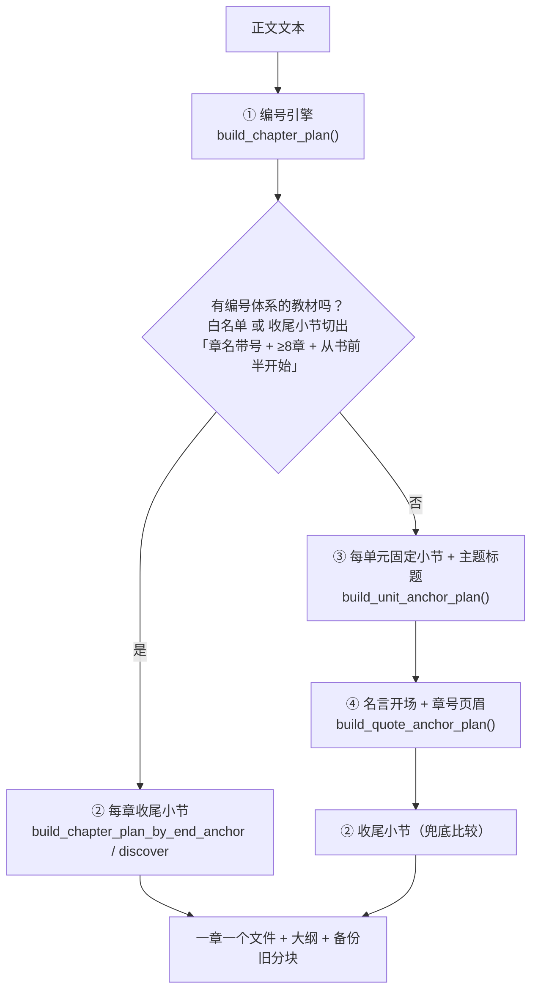

# 📖 教材分块说明

把厚教材 PDF 放进来（或放任意位置），然后运行：

```
python "_工具/split_textbook.py" "教材.pdf" --out "04-教材分块" --ocr mineru --mineru-token "你的Token"
```

## 最省事的方式：双击启动器

1. 双击 `_工具/拆书.bat`（首次先运行一次 `_工具/设置MinerU令牌.bat` 保存 Token）
2. 选择教材 **PDF**（扫描版 / 数学书均可），按回车
3. 等 MinerU 云端解析完成，输出到 `04-教材分块/<书名>/`

> Linux 版拆书只走 MinerU：云端 OCR + 公式转 LaTeX，再按章节拆成一章一个文件。
> 750 页的书大约需要 20-40 分钟；每日免费 1000 页。

例如：

```
python "_工具/split_textbook.py" "/home/me/Downloads/Python入门教材.pdf" --out "04-教材分块" --ocr mineru --mineru-token "你的Token"
```

支持格式：**仅 PDF**（EPUB / Word 不在 Linux 版支持范围）。

## 常用参数

| 参数 | 作用 | 默认 |
| --- | --- | --- |
| `--out` | 输出文件夹 | 当前目录的 `教材分块` |
| `--max-chars` | 已停用：一章一个文件，不再按字数切块 | — |
| `--overlap` | 相邻块重叠字符数（防止切断关键句） | 200 |

## 输出结构

```
04-教材分块/
└── <书名>/
    ├── 00-教材信息.md      ← 全书信息、总字数
    ├── 00-目录.md          ← 所有分块清单
    ├── 01-全书大纲.md       ← 章节大纲 + 进度勾选清单
    ├── 章节01-第1章 概述.md
    ├── 章节02-第2章 ....md
    └── ...
```

然后：

- 在 Claudian 输入 `/拆书` 可让 AI 汇报章节清单；
- 打开 `01-全书大纲.md` 查看全书骨架、勾选学习进度；
- 用 `/新主题-拆解与计划 <主题名>` 基于大纲生成水平拆解和学习计划；
- 学完一章后运行 `/更新进度` 自动勾选。

> 说明：默认**按章节拆分，一章一个文件**，章节内部不再切分，
> 公式不会因截断显示错误；识别不到章节时全书存为一个文件并提示校准。

---

## 🧩 切分策略（2026-10-07 大改：多策略 + 互斥门槛）

`_工具/split_textbook.py` 现在按下面的顺序**依次算候选、再用门槛决定谁赢**（不是"先命中先用"了）：



| 顺序 | 策略 | 适用 | 触发条件 |
|---|---|---|---|
| ① | **编号引擎** | 有 `UNIDAD 3 / 第 3 章 / Chapter 3` 的书 | 总是先跑 |
| ② | **每章固定收尾小节** | 章标题被 OCR 打掉、但每章都以同一小节收尾 | 3 条：① 命中**编号教材白名单**（`NUMBERED_BOOK_KEYWORDS`，现在是「某外语教材」「循序渐进外语语法」）或 ② 它切出**章名自带章号 + ≥8 章 + 从书前半开始**的完整章表（`_looks_numbered_sequence`）且编号引擎 <4 章 |
| ③ | **每单元固定小节 + 主题标题** | **整本没有章号**的词汇/会话/练习册 | 单元数 ≥3 且（当前 <4 章 或 ≥当前×2.2）；**并且自检通过** |
| ④ | **名言开场 + 章号页眉** | 章标题整批丢失、但每章以「英文名言 + 署名 + 中文出处」开场的外文词书 | 章数 > 当前，**且真锚点占比 ≥60%**，且（当前 <4 或 ≥当前×1.5） |

### 各策略的判定要点

- **① 编号引擎**：抽目录（只认"带引导点/尾随页码"的行）→ 收章号锚点 → 滤掉"密集编号簇"（章首小目录/习题列表）→ 书后区硬截断 → 目录缺号时用锚点反推。
  - **目录页码插值补齐（2026-10-07 加）**：目录声明 N 章、正文只认出 M 章（章标题被 OCR 打掉）时，用**目录页码**在相邻已定位章之间按比例补出缺号章，标题标「（章界估算·按目录页码插值）」。第 1 章用「目录区末尾」当虚拟起点。
    《大学意大利语教程 1》实测：只认出 10 课 → 补到 16 课。
  - **开场小节预设 `OPENER_PRESETS`（2026-10-07 加）**：章标题丢了、但每课都以同一个小节开场的书，把那个小节喂给编号引擎就能**精确**切（不靠估算）。现已收录《大学意大利语教程》《现代意大利语》→ `Impariamo a parlare`。加新书就往下加一行。
- **② 收尾小节**：你给了 `--chapter-end-pattern` 或命中预设就用它；`auto` 时从正文自己挖「每章出现且只出现一次、间隔 ≥2500 字且均匀」的小节。
- **③ 主题标题**：两类锚点——**每单元固定小节**（默认 `本课聚焦/学习目标/Objetivos/Foco/Learning objectives`，可用 `--opener-pattern` 覆盖）∪ **主题标题行**（字母开头 + 行尾中文 + 拉丁部分有 **≥3 个连续大写字母**）。两类相距 <40 行合并；章名取锚点向上最近的标题行。
  - **三类假阳性已挡**：数字开头（`## 1 请阅读…`）、罗马数字习题（`## VII. 请…`）、骨架小节（`TEXTOS 课文 / VOCABULARIO 词汇表 / PALABRAS ADICIONALES …`，见黑名单 `STRUCT_HEAD_WORDS`）。
  - **自检**：锚点标题若自带章号且**章号大量重复**（同一章多个标题）→ 判定"这是有编号体系的书"，本策略主动退出。
- **④ 名言开场**：锚点三来源——**名言块**（行尾或独立行的 `—作者`、`——出处`，只认全角破折号！）∪ **章号页眉**（`## 14` 这类只留下数字的页眉）∪ **`Chapter X 主题` 标题**。章名从**书的目录行**（`Chapter 12 饮食健康 145`）按号取；
  - 名言锚点不带号 → **往后 300 行内借章号页眉的号**，借不到才 = 上一个号 +1；
  - 与上一个**已接受**章首距离 <200 行的候选只用来补章名，不新开章（否则一章会被拆好几次）；
  - **缺号章**用「相邻真锚点 + 目录页码」按页数比例**插值**补，标题里会写「（章界估算 · 按目录页数插值）」。

### 只读审计 `--audit`（2026-10-07 加）

改完策略**必须**跑一次回归（任何"本来能正常切分"的书都不能被切碎）：

```bash
_工具\.venv\Scripts\python.exe _工具/split_textbook.py "04-教材分块" --out "04-教材分块" --audit
```

它按书打印「通用 / 单元 / 名言 / 收尾」四个候选的章数、实际选中的策略、盘上现有分块数，**有落差会打 ⚠️**，全程**不写任何文件**（约 3.5 秒跑完全库）。`05-日程安排/_scripts` 的自检**第 11 项**已经把它自动化了。

### 实测（全库 16 本书审计 + 四本详看）

| 书 | 结果 | 说明 |
|---|---|---|
| 某外语教材 学生用书 1 | **18 块**（16 课 + 书前 + 总词汇表） | 编号教材 → ② 收尾小节（「作业 Trabajos de casa」×16） |
| 词汇 初级（40 单元） | **41 块** | ③ 主题标题（配 `本课聚焦`） |
| 词汇 中级（34 单元） | **35 块** | ③ 主题标题 |
| IELTS 外语科词汇真经（22 章） | **24 块 = 22 章 + 书前 + 索引** | ④ 名言开场：21 章真锚点、**Ch11 时尚潮流为页数插值估算** |
| 大学意大利语教程 1（16 课） | **16 块** | ① 编号引擎 + 开场小节预设（`Impariamo a parlare`）；无预设时只认出 10 课、靠页码补齐也够 |
| 专业课D / 西方经济学 / 专业课F / 统计学 / CS229 / 专业课C / 宏观 / Macroeconomics 等 | **全部不动** | 通用编号引擎直接可用；③④ 的门槛把它们挡住了 |

> ⚠️ **两条注意**
> 1. ③④ 两条只解决"**有规律却没章号**"的书；章标题**真的丢了**又没有其它周期信号的书，救不回来（会 2–3 章合并）。
> 2. 改策略后**必须回归测试**：`--audit` 全库无 ⚠️ + 自检第 11 项通过（《某外语教材1》16 章、《专业课D》9 章这类"本来切得好"的书一次都不能被切碎）。
> 3. 新增/调整策略后，顺手把这次踩的坑写进注释（本文件 + `split_textbook.py` 顶部的常量注释），下次别再踩。
